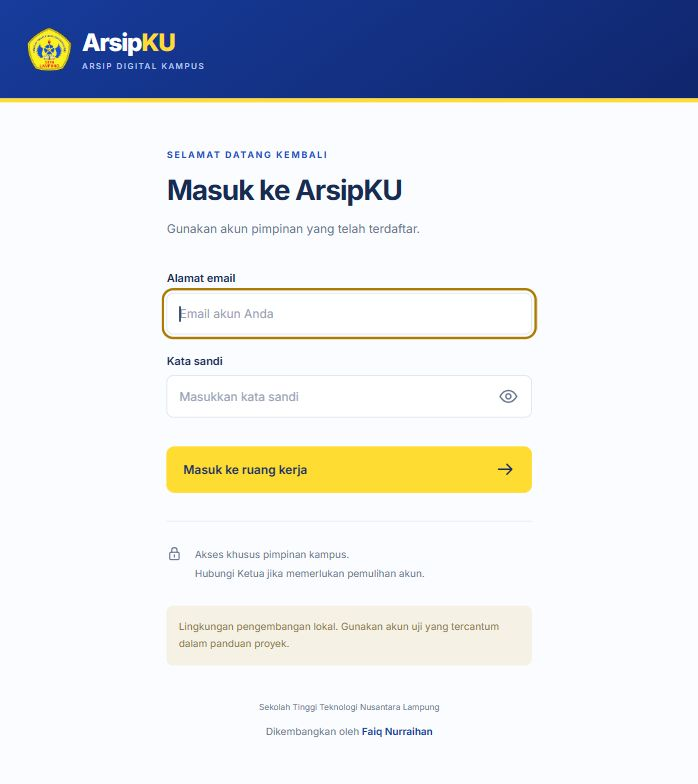
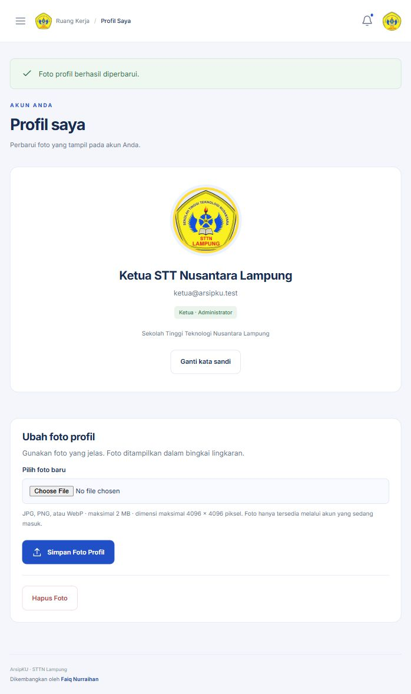
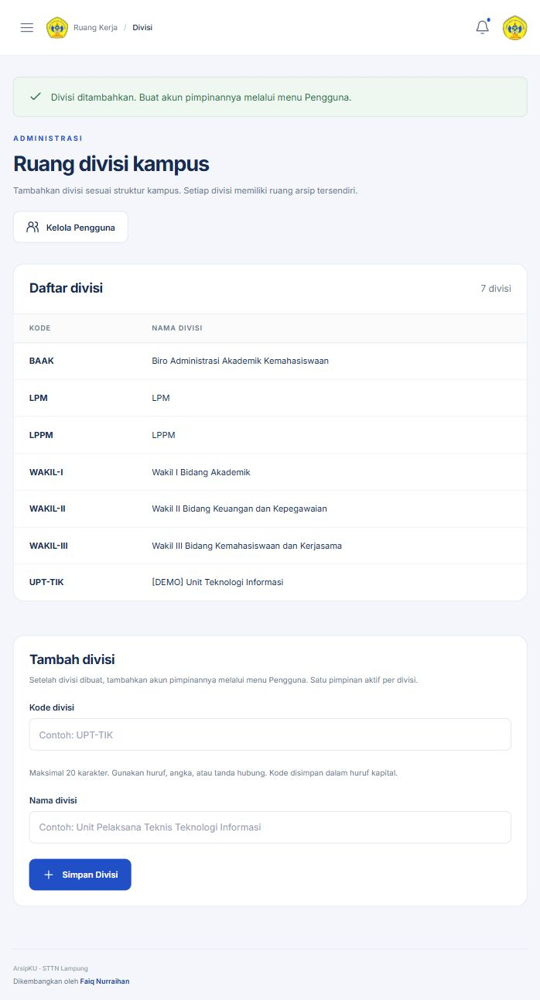

# ArsipKU

**Sistem arsip digital kampus dengan validasi pimpinan dan akses berdasarkan divisi.**

Portofolio proyek Laravel full stack oleh **Faiq Nurraihan**, dengan studi kasus pengarsipan dokumen di Sekolah Tinggi Teknologi Nusantara Lampung.

`Laravel 13` · `PHP 8.3+` · `Blade` · `MySQL / SQLite` · `Versi 1.1`

## Tentang proyek

ArsipKU membantu pimpinan divisi mencatat, mencari, dan menelusuri dokumen beserta lampirannya. Setiap versi dokumen harus diperiksa Ketua sebelum menjadi arsip aktif. Akses setiap pimpinan terbatas pada divisinya; Ketua merangkap Administrator dan Validator untuk seluruh institusi.

Repository ini memuat source, migrasi, pengujian, serta screenshot dari data demo lokal. Konfigurasi produksi, akun produksi, database, dokumen kampus, dan berkas foto pengguna tidak disertakan.

## Fitur utama

- Pengarsipan metadata, pencarian, filter, pratinjau PDF/gambar, unduhan, dan ekspor CSV.
- Satu berkas utama dengan beberapa lampiran dalam satu paket versi.
- Draf, pengajuan terkunci, penarikan, persetujuan, permintaan revisi, dan penolakan.
- Versi aktif lama tetap tersedia selama versi baru diperiksa; berkas yang disetujui tidak ditimpa.
- Isolasi divisi pada halaman, pencarian, ekspor, notifikasi, dan akses langsung ke berkas.
- Tambah divisi, kelola kategori, dan satu pimpinan aktif per divisi.
- Login, pembatasan percobaan, ganti kata sandi, penonaktifan akun, serta foto profil privat.
- Riwayat aktivitas dan keputusan, serta notifikasi dalam aplikasi.
- Tema biru-kuning STTN Lampung, logo institusi, serta kredit developer.

## Pratinjau

Gambar berasal dari lingkungan lokal dengan data contoh. Logo dipakai sebagai foto uji pada akun demo; pengguna dapat memasang fotonya sendiri.



<details>
<summary>Foto profil dan administrasi divisi</summary>





</details>

## Hak akses

| Peran | Dokumen | Validasi | Administrasi |
|---|---|---|---|
| Ketua / Administrator / Validator | Seluruh divisi | Memberikan keputusan | Divisi, akun pimpinan, kategori |
| Pimpinan divisi | Divisi sendiri | Mengajukan dan memperbaiki | Foto profil dan kata sandi sendiri |

Enam divisi awal: Wakil I, Wakil II, Wakil III, LPPM, LPM, dan BAAK. Administrator dapat menambahkan divisi berikutnya. Tidak tersedia pendaftaran publik atau akun staf.

## Alur dokumen

1. Pimpinan membuat draf, mengisi metadata, dan mengunggah berkas utama beserta lampiran.
2. Pimpinan mengajukan paket versi kepada Ketua; pengajuan terkunci selama pemeriksaan.
3. Ketua menyetujui, meminta revisi, atau menolak. Catatan wajib untuk revisi dan penolakan.
4. Paket yang disetujui menjadi versi aktif. Perubahan berikutnya dibuat sebagai versi baru.

Token pengajuan menolak keputusan dari halaman lama setelah paket berubah dan diajukan ulang.

## Teknologi dan struktur

| Bagian | Implementasi |
|---|---|
| Backend | Laravel 13, PHP 8.3+ |
| Antarmuka | Blade, CSS/JavaScript lokal; tanpa Node/Vite build |
| Database | MySQL/MariaDB untuk hosting; SQLite untuk pengembangan/pengujian |
| Berkas | Disk privat; unduhan melalui controller dengan pemeriksaan hak akses |
| Pengujian | PHPUnit, feature tests, SQLite dalam memori, disk uji terpisah |
| Target deployment | Hosting PHP dengan cPanel dan document root `public` |

- `app/Services/ArchiveWorkflow.php`: perubahan paket, pengajuan, dan keputusan dengan transaksi serta penguncian dokumen.
- `app/Http/Controllers/`: autentikasi, arsip, dashboard, administrasi, dan profil.
- `database/migrations/`: skema database dan perubahannya.
- `resources/views/`: halaman Blade dan komponen antarmuka.
- `public/`: aset aplikasi dan logo; dokumen privat disimpan di luar folder ini.
- `tests/Feature/`: pengujian alur bisnis, otorisasi, unggahan, profil, dan divisi.

## Menjalankan secara lokal

Siapkan PHP 8.3+, Composer 2, serta ekstensi Laravel termasuk `fileinfo`, `mbstring`, `openssl`, `pdo`, dan `pdo_sqlite`. Gunakan `pdo_mysql` jika memilih MySQL. Jalankan dari folder yang berisi `artisan` dan `composer.json`:

```bash
composer install
php -r "file_exists('.env') || copy('.env.example', '.env');"
php -r "file_exists('database/database.sqlite') || touch('database/database.sqlite');"
php artisan key:generate
php artisan migrate
php artisan db:seed
php artisan arsipku:admin admin@example.test
php artisan serve --host=127.0.0.1 --port=8000
```

Masukkan kata sandi pilihan Anda minimal 12 karakter yang mengandung huruf dan angka saat pembuatan akun. Tidak tersedia kata sandi bawaan atau akun demo siap pakai.

Buka **http://127.0.0.1:8000**, login dengan akun yang baru dibuat, lalu buat akun pimpinan melalui **Pengguna**. Database awal berisi enam divisi dan kategori; dokumen dibuat melalui aplikasi.

## Pengujian dan verifikasi

```bash
php artisan test
composer validate --strict
composer check-platform-reqs --no-dev
```

Source aplikasi v1.1 lulus **36 tes / 250 assertions** pada PHP 8.3.35 dengan SQLite. Cakupannya meliputi pembatasan akses divisi, unggahan lampiran, keputusan kedaluwarsa, versi aktif, akun nonaktif, foto privat, divisi, serta pelestarian data lama saat migrasi.

Login, unggah foto, dan tambah divisi juga diperiksa melalui browser lokal. Pengujian lokal tidak menggantikan UAT, uji database hosting, uji beban, atau uji pemulihan pada lingkungan tujuan.

## Deployment dan dokumentasi

Gunakan `.env.hosting.example` sebagai referensi konfigurasi. Document root harus menunjuk ke **`public`**. Simpan dokumen/foto di `storage/app/private`, pertahankan `APP_DEBUG=false`, serta aktifkan HTTPS.

- [Panduan pengguna](docs/PANDUAN-PENGGUNA.md)
- [PRD awal proyek](docs/PRD-ArsipKU-v1.0.md)

GitHub menyimpan source dan dokumentasi. Backend Laravel dijalankan pada hosting PHP dan database tersendiri.

## Pengembangan berikutnya

OCR/pencarian isi dokumen, tanda tangan elektronik, notifikasi email, otomatisasi backup, serta perpindahan arsip antar divisi belum diimplementasikan. Backup/pemulihan mengikuti prosedur operasional.

## Kredit

**Developer:** Faiq Nurraihan. Logo STTN Lampung digunakan sebagai identitas institusi pada studi kasus. Laravel dan dependensi pihak ketiga mengikuti atribusi dan lisensi paket masing-masing.
